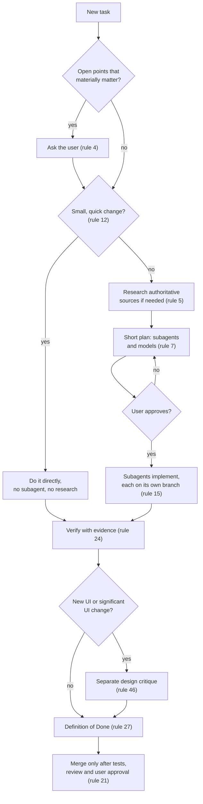
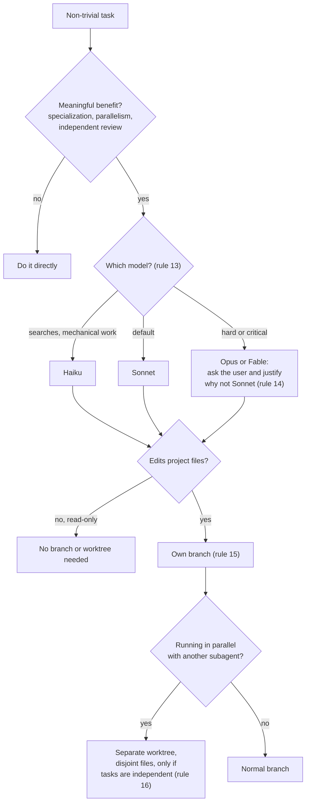

# claude-code-dev-rules

A global `CLAUDE.md` with general software development rules for [Claude Code](https://claude.com/claude-code). It tells Claude how to ask questions, where to get its facts, when to delegate to subagents, how to handle Git safely, how to document work, and how to build UI/UX that does not look AI-generated.

The rules are written to be read by the model, but they are plain English: you can also use them as a checklist for your own team.

Current version: **1.0.0** (see the [changelog](CHANGELOG.md)). Licensed under [CC BY 4.0](#license-and-attribution): reuse it freely, but credit the author.

## Quick start

1. Copy [`CLAUDE.md`](CLAUDE.md) to `~/.claude/CLAUDE.md` (details in [Install](#install)).
2. Change rule 1, which sets the conversation language to Italian.
3. Read [Rules are guidance, not enforcement](#rules-are-guidance-not-enforcement) if you want the safety rules to be a hard block.

## Contents

- [Philosophy](#philosophy)
- [How a task flows](#how-a-task-flows)
- [What the rules say](#what-the-rules-say)
- [Confidence levels](#confidence-levels)
- [Subagents: when, which model, which branch](#subagents-when-which-model-which-branch)
- [Documentation layout](#documentation-layout)
- [Install](#install)
- [Adapt before using](#adapt-before-using)
- [Context cost and modular use](#context-cost-and-modular-use)
- [Rules are guidance, not enforcement](#rules-are-guidance-not-enforcement)
- [Editing the rules](#editing-the-rules)
- [Versioning](#versioning)
- [License and attribution](#license-and-attribution)

The full text is in [`CLAUDE.md`](CLAUDE.md) (49 numbered rules, plus a UI/UX standards appendix).

## Philosophy

Five ideas run through every rule:

1. **Honest.** Never invent anything. If the answer is not known, research it from authoritative sources, and say how sure you are.
2. **Proportional.** Every rule scales with the size, complexity and risk of the project. A small fix does not need a plan, a subagent and a design review.
3. **Safe by default.** No push, no destructive command, no install and no external upload without explicit consent. No rule and no approved plan can bypass these.
4. **Verifiable.** Nothing is "done" without evidence: test output, a real run, a screenshot.
5. **Delegated, but controlled.** Subagents do the work, the main agent checks it, and a human approves what matters.

## How a task flows



## What the rules say

| Area | Rules | In short |
|------|-------|----------|
| Communication | 1-3 | Talk in the user's language, code and docs in English. Never invent. Show confidence when it matters. |
| Before starting | 4-7 | Ask when a gap affects the outcome, otherwise state the safest assumption. Research in proportion to the task. Define engineering standards once per project. Approve a short plan, then work autonomously. |
| Documentation | 8-11 | Markdown only, diagrams in Mermaid, everything under one `docs/` folder split by topic. Record decisions. Leave a handoff note after long sessions. |
| Subagents | 12-19 | Use them when they add real value. Pick the cheapest model that fits. Ask before using Opus or Fable. One branch per subagent that edits files. Respect task order. The main agent checks the report. Stop after two failures. |
| Git and safety | 20-23 | No push, fetch, pull or force-push without consent. No destructive command without approval. Merges are done by the main agent after approval. No installs or system changes without consent. |
| Quality | 24-29 | Verify before claiming success. Tests for new logic. Minimal scope. One Definition of Done. Conventional Commits and SemVer. Check dependencies before adding them. |
| UI/UX process | 30-43 | At least 3 mockups to choose from. Guide non-designers. Document the design system. Define the accessibility level and measure contrast. Realistic content, purposeful motion, platform guidelines, design tokens, evidence-based visual checks, licensed assets, clear microcopy, theme and language decisions up front. |
| Proportionality | 44-45 | Apply every rule in proportion. Before running a workflow, check that every step is allowed. Never break one safety rule to satisfy another. |
| Critique, robustness, decisions | 46-49 | An independent design critique of new UI. Edge cases and failure scenarios for non-trivial features. Performance measured, not guessed. ADRs for significant decisions. |
| UI/UX design standards | appendix | A checklist of design philosophy, typography, layout, components, UX states, anti-AI patterns and a final quality check. |

### Engineering standards chosen per project (rule 6)

At the start of each project the rules ask for a short document that marks each of these as adopted or discarded, with a rationale and sources: Clean Code, Design Patterns, SOLID, DRY, KISS, YAGNI, Separation of Concerns, Composition over Inheritance, Fail Fast, TDD, BDD, unit, integration and end-to-end testing, Code Review, Static Code Analysis, Continuous Integration, OWASP Top 10, Security by Design, Least Privilege, Zero Trust, Defensive Programming and the 12-Factor App. Nothing is adopted just because it is on the list.

## Confidence levels

Rule 3 asks Claude to state how sure it is whenever that changes your decision:

| Level | Meaning |
|-------|---------|
| Certain | Verified in the current session, confirmed by official documentation that was consulted, or recorded in the project's documentation with source, date and a matching version. |
| Probable | Reliable sources not verified here, concordant non-primary sources, or project notes without source, date or version. |
| Unsure | A single non-authoritative source, reasoning alone, or recall from training data about things that change (versions, APIs, prices). |
| Don't know | Said plainly, never invented. |

## Subagents: when, which model, which branch



## Documentation layout

Rule 9 keeps all documentation under one `docs/` folder, split by topic so subjects are never mixed:

```text
docs/
├── standards/    engineering standards, accessibility level (rules 6, 33)
├── specs/        what to build
├── plans/        how to build it
├── progress/     handoff notes between sessions (rule 11)
├── design/       design direction, design system, user flows
│   ├── mockups/      static HTML mockups (rule 30)
│   └── prototypes/   interactive prototypes, when justified
└── decisions/    Architecture Decision Records (rule 49)
```

If a project already has an established documentation folder, keep using it.

## Install

Copy the file to your global Claude Code instructions:

```bash
# you have no global file yet
cp CLAUDE.md ~/.claude/CLAUDE.md

# you already have one: back it up first, then merge by hand
cp ~/.claude/CLAUDE.md ~/.claude/CLAUDE.md.bak-$(date +%Y%m%d)
```

Claude Code reads `~/.claude/CLAUDE.md` at the start of every session. A project's own `CLAUDE.md` takes precedence where it is stricter, and so do a project's established design decisions (see the "Precedence" line at the top of the file).

## Adapt before using

These rules reflect the author's preferences. Check at least:

- **Rule 1, language**: it tells Claude to talk to the user in Italian. Change it to your language.
- **Rule 9, documentation folder**: the rules use `docs/`. Change it if your projects use another name.
- **Rules 15 and 21, branching**: the rules follow the project's own branching strategy and name `develop` only as an example.
- **Rules 12 to 14, subagents and models**: the model names (Haiku, Sonnet, Opus, Fable) and the cost/benefit policy depend on the plan you have.
- **Rule 30, mockups**: requiring at least 3 mockups is a deliberate choice for UI work; remove it if it does not fit your workflow.
- **Rule 5, research**: it assumes Claude can search the web. Adjust it if your sessions are offline.

## Context cost and modular use

`CLAUDE.md` is about 21 KB and is loaded at the start of every session, so it uses part of the model's context window each time. The token count has not been measured here.

If you do not build user interfaces, you can drop the UI/UX parts and keep the rest:

- rules 30 to 43 (UI/UX process), rule 46 (design critique), rule 48 (frontend performance) and the "UI/UX design standards" appendix;
- then fix the references that pointed to them: the "Precedence" line (mentions design decisions), rule 8 (UI mockups and prototypes), rule 9 (the `docs/design/` example) and rule 27 (the Definition of Done mentions the design critique and the final quality check).

## Rules are guidance, not enforcement

The text in `CLAUDE.md` is an instruction to the model, not a technical barrier. A model can misread it or forget it. For the safety rules (20 to 23: push, destructive commands, installs) you can add a hard block with permission rules in `~/.claude/settings.json`:

```json
{
  "permissions": {
    "deny": [
      "Bash(git push *)",
      "Bash(git reset --hard *)",
      "Bash(git clean *)"
    ]
  }
}
```

What the official documentation says (source: [Configure permissions](https://code.claude.com/docs/en/permissions), read on 2026-11-12):

- Rules are evaluated in the order deny, then ask, then allow, and the first match wins.
- Use an `ask` list instead of `deny` if you want a prompt rather than a block.
- A Bash rule matches the command text as Claude writes it. It is not a security boundary: `Bash(git push *)` stops `git push origin main` but not `git -C . push origin main`.
- For enforcement that does not depend on the command text, the documentation points to sandboxing and to `PreToolUse` hooks.

Check the page above for the current syntax before relying on it: the permission system can change between Claude Code versions.

## Editing the rules

The rules refer to each other by number (for example rule 27 points to rules 24, 25, 26, 46 and 47). If you add, remove or reorder a rule, update the references too. Prefer extending an existing rule over adding a new numbered one.

## Versioning

The repository follows [Semantic Versioning](https://semver.org/) and every release is a Git tag (`v1.0.0`, ...). Changes are listed in [`CHANGELOG.md`](CHANGELOG.md). For a set of rules, the numbers mean:

| Bump | When | Example |
|------|------|---------|
| Major (`2.0.0`) | A rule is removed or renumbered, or its meaning changes in a way that can alter existing behavior. | Dropping the mockup requirement. |
| Minor (`1.1.0`) | A new rule is added, or a rule is extended or relaxed without changing the existing ones. | A new rule on logging. |
| Patch (`1.0.1`) | Typos, wording and README changes that do not change what a rule asks for. | Fixing a broken cross-reference. |

## License and attribution

Copyright (c) 2026 d4n1x86. Licensed under the [Creative Commons Attribution 4.0 International License](https://creativecommons.org/licenses/by/4.0/) (CC BY 4.0). The full legal text is in [`LICENSE`](LICENSE).

You may share and adapt this work, including commercially, as long as you:

- give appropriate credit,
- link to the license,
- indicate if you made changes.

Suggested attribution:

> Based on [claude-code-dev-rules](https://github.com/d4n1x86/claude-code-dev-rules) by d4n1x86, licensed under [CC BY 4.0](https://creativecommons.org/licenses/by/4.0/).

Earlier commits, up to and including `a6da19c`, were published under the MIT License. Versions from `v1.0.0` on are licensed under CC BY 4.0.
